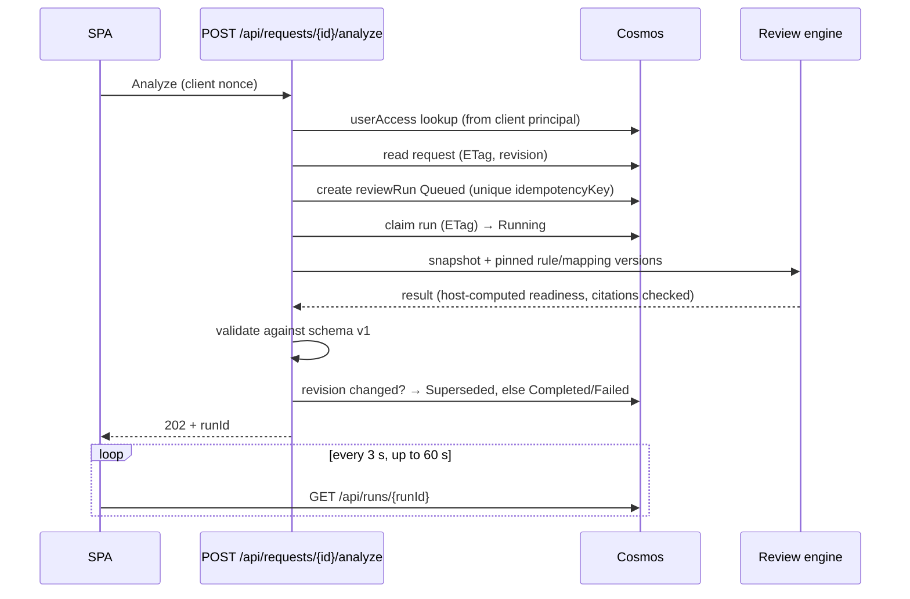
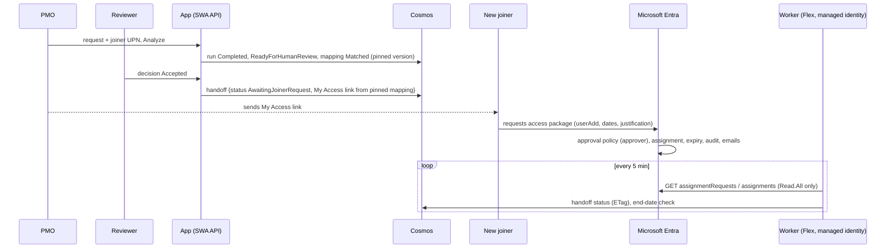
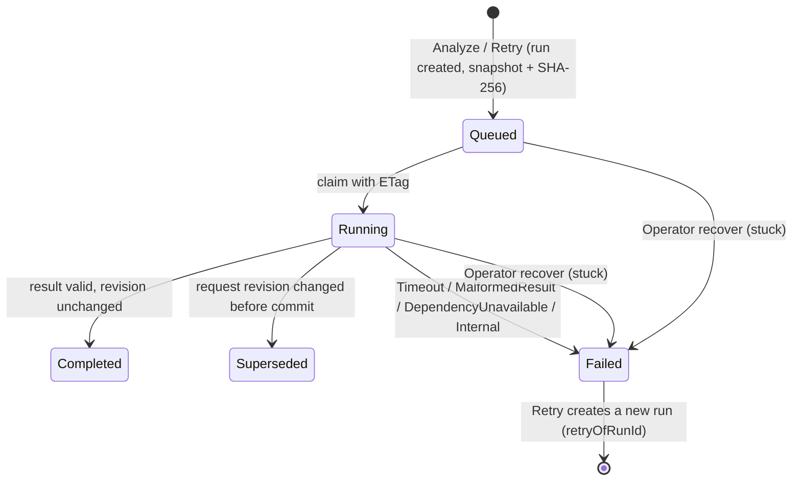

# Architecture — PMO Request Review Pilot

Scope is the locked v1.0 scope. Only the hosting stack changes for the pilot. Every paid component sits behind an interface so the same code is promoted later.

## Component diagram

Solid lines run in the pilot. Dashed boxes are coded, tested with mocks, and switched off by config.

## Stack mapping (A1)

| Locked design (paid) | Zero-cost pilot (Azure) | Promotion path (paid, later) |
|---|---|---|
| Model-driven Power App | SWA **Free**, SPA UI | Keep SWA (Standard) or move UI to Power Apps |
| Entra sign-in via Power Apps | SWA built-in auth, pre-configured Entra ID | SWA Standard custom Entra app registration |
| Dataverse tables + security roles | Cosmos DB NoSQL **free tier** + server-side `userAccess` | Dataverse, or Cosmos with managed identity |
| Dataverse plug-in snapshot | API creates snapshot + SHA-256 server-side | Dataverse custom API |
| Power Automate processing flow | `IReviewDispatcher` → `InlineDispatcher` | Queue-triggered Function or Power Automate flow |
| Azure Functions (isolated) | SWA **managed** Functions, C# isolated, HTTP only | BYO Function App + managed identity + Key Vault |
| Azure OpenAI reviewer | `IReviewModel` → `RuleOnlyReviewModel` | `AzureOpenAIReviewModel` (coded, tested, disabled) |
| Application Insights | Off; structured logs only | App Insights with sampling |
| Azure Pipelines | SWA CLI deploy | Azure Pipelines, multi-stage |

## Analyze flow (pilot)

**Honest limitation:** in the pilot the engine runs inside the Analyze HTTP call. The SWA gateway cuts API calls at 45 s (`VERIFIED_FACTS` F3), so the processing budget is capped well below that. If the browser closes after the request is accepted, the function keeps running and persists the run; the user sees it in history on return. A true background queue is the paid `QueueDispatcher` path.

## Trust boundaries
1. Browser → SWA: authenticated by SWA. Everything from the browser is untrusted, including body fields naming users or projects.
2. Function → Cosmos: connection string from SWA app settings (no managed identity on managed Functions, F2).
3. Request text → reviewer: untrusted content. Never interpreted as instructions.
4. Reviewer output → host: untrusted. Host recomputes readiness and validates every citation against pinned versions.

## API (as built)

All routes are under `/api`, require SWA sign-in, and take identity **only** from `x-ms-client-principal`. Project-scoped routes check the caller's `userAccess` grant for `{projectId}` before any read; a project the caller has no role in returns **404** (existence is not revealed), a role without the permission returns **403**.

| Method + route | Permission (roles) |
|---|---|
| GET `me` | any signed-in user (empty project list if unregistered) |
| GET/POST `projects/{projectId}/requests` | View (PMO, Reviewer) / Edit (PMO) |
| GET/PUT `projects/{projectId}/requests/{requestId}` | View / Edit — PUT needs `If-Match`; server bumps `revision` |
| POST `projects/{projectId}/requests/{requestId}/analyze` `{nonce}` | Analyze (PMO) → 202 `{runId, processingStatus, duplicate}` |
| GET `projects/{projectId}/requests/{requestId}/runs` | ViewRuns (PMO, Reviewer, Operator) |
| GET `projects/{projectId}/runs/{runId}` | ViewRuns |
| POST `projects/{projectId}/runs/{runId}/retry` `{nonce}` | Analyze — only a Failed run of the current revision |
| GET/POST `projects/{projectId}/runs/{runId}/decisions` | ViewRuns / RecordDecision (Reviewer) — quality feedback, not approval |
| GET `attention` | Reviewer projects only: latest Failed or ManualReviewRequired run per request |
| GET/POST `projects/{projectId}/rules`, `.../mappings` | ViewReferenceData / ManageReferenceData (Maintainer) — creates a new Draft version |
| POST `projects/{projectId}/rules/{id}/status`, `.../mappings/{id}/status` | Maintainer — Draft→Published→Retired only, `If-Match` |
| POST `projects/{projectId}/operator/recover` | RecoverRuns (Operator) |
| GET `projects/{projectId}/requests/{requestId}/handoffs` | ViewRuns — Phase 2, read-only; `{enabled, items}` |

No route writes `result`, `snapshot`, versions or status; only `ReviewProcessor` does (AC12). No route writes hand-off records; an Accepted decision creates one, the worker updates it.

## Phase 2: Entra hand-off (Option A, approved 16 Oct 2026)

| Concern | Design |
|---|---|
| Who approves | Entra approval policy on the access package. The app's Accepted is a readiness sign-off, not approval. |
| Who assigns / removes | Entra (access package resource role + expiry). The app holds no write permission. |
| Identity matching | Snapshot `joinerUpn` vs Entra `requestor`/`target` `principalName` or `email`, case-insensitive; only requests created after the hand-off (−10 min). |
| Drift check | Entra end date later than the reviewed end date (or none) → visible warning. |
| Failure | Graph errors stored as a category; last known status kept; retried next cycle. |
| Privilege | Worker: Graph `EntitlementManagement.Read.All`; Cosmos data role on `handoffs` only; Storage Blob Data Owner on its own account. No keys. |
| Switch off | `ENTRA_HANDOFF_ENABLED=false` (SWA) stops new hand-offs; stopping the worker stops cost. Review flow unaffected. |

## Design decisions that differ from the prompt (with reasons)

| Prompt | Built | Why |
|---|---|---|
| `IReviewDispatcher.DispatchAsync(reviewRunId, correlationId)` | `DispatchAsync(projectId, reviewRunId, correlationId)` | Runs are partitioned by `/projectId`; a single-partition read is cheap and stays within one authorised project. A lookup by id alone is a cross-partition query. |
| Idempotency key `requestId + revision + nonce` | Kept (unique key), **plus** deterministic run id `{requestId}.r{revision}.a{attempt}` | The nonce key alone allows two runs if two tabs send different nonces. The deterministic id makes concurrent Analyze calls collide, so one revision has one run unless a Failed run is explicitly retried (AC13, AC14). |
| `az deployment group what-if` | `az deployment sub what-if` | The resource group is created by the deployment, so it must also pass the approval gate. |
| Functions Core Tools for local runs | `tools/local-api` (dev-only, loopback) behind the SWA CLI emulator | Core Tools binaries could not be downloaded in the build environment. Both hosts call the same `ApiHost`. |
| Request form "validation" | Client-side length/date hints only; empty fields allowed | The review must be able to report missing fields; the server enforces lengths and types. |

## Processing statuses

