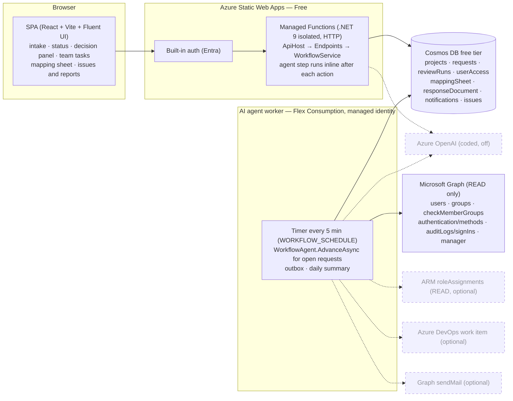

# Architecture — PMO onboarding flow (v2)

v2 (17 Oct 2026). The AI agent reviews, validates, summarises, routes, tracks, verifies and reports; it **never approves, creates or assigns**. People decide (named Owner, then Security); the ID team and the role assignment team make the changes in their own tools and record them here. Scope: `SCOPE.md`.

## Components

The SWA managed API has **no managed identity** (F2), so it cannot read Entra. The review it runs inline marks the Entra cross-check *Pending*; the worker completes it. A request is never sent for approval while any check is Pending (outcome precedence: Fail > Pending > Pass). Locally (`PILOT_LOCAL_DEV` + `ALLOW_UNVERIFIED_ENTRA`) the Entra checks show "not checked (local development)".

## Request lifecycle

```mermaid
stateDiagram-v2
  [*] --> Submitted: requester submits (intake validated, domain ID derived)
  Submitted --> AiReview: agent starts review (idempotency key = request id + step)
  AiReview --> AwaitingOwner: PASS (all checks, Entra cross-check done)
  AiReview --> Returned: FAIL (reasons to requester + PMO)
  Returned --> Submitted: requester corrects and resubmits
  AiReview --> FailedNeedsDev: review failed 3 times
  AwaitingOwner --> AwaitingSecurity: named Owner approves
  AwaitingOwner --> Rejected: Owner rejects (remarks)
  AwaitingSecurity --> WithIdTeam: Security approves
  AwaitingSecurity --> Rejected: Security rejects (remarks)
  WithIdTeam --> WithRoleTeam: report verified (user, group, naming, membership, sheet, TAP rules)
  WithIdTeam --> WithIdTeam: mismatch → task returned with the exact difference
  WithRoleTeam --> Verifying: exact roles verified
  WithRoleTeam --> WithRoleTeam: mismatch → task returned
  Verifying --> Completed: sign-in, permanent method, TAP deleted, access present
  Verifying --> WithIdTeam: access not in place
  Verifying --> FailedNeedsDev: past VERIFY_SLA_HOURS
  AwaitingOwner --> AiReview: mapping sheet changed (also from AwaitingSecurity, WithIdTeam, WithRoleTeam)
  FailedNeedsDev --> Submitted: Operator resumes after the fix (failed review → new review; other stages resume where they failed)
```

After a mapping change the review is re-run: if the reviewed group and role are unchanged the request resumes its stage; otherwise the approvals are superseded and it goes back to Awaiting Owner.

## Stage → code

| Stage | Code | Notes |
|---|---|---|
| 1 Intake | `Services/RequestService` | Required fields; safe format fixes (spaces, case); missing fields returned in `error.details` (`incomplete_request`). |
| 2 AI review | `Review/ReviewEngine`, `Review/ReviewChecks`, `Processing/RunService` + `ReviewProcessor` | Reads both sources fresh (`Sources/StoreSourcesOfTruth`, 3 attempts). Result validated against `schema/review-result.v2.json`. Sheet fingerprint (SHA-256 of the resource's rows) stored on the run. |
| 3 Approvals | `Workflow/WorkflowService.RespondAsync` | Only the named Owner (sign-in name), then a Security member who is not the Owner approver; tied to request id + reviewed run id. Others → ignored, *Unauthorized approval* issue, Security alerted. |
| 4 ID team | `WorkflowService.ReportIdTeamAsync`, `Workflow/Verifier.IdTeamAsync` | TAP metadata only; the body is rejected if it carries a pass value. |
| 5 Role team | `WorkflowService.ReportRoleTeamAsync`, `Verifier.RoleTeamAsync` | Exact roles vs response document; optional ARM read. Response document updated with what was assigned. |
| 6 Final | `WorkflowAgent.FinalAsync`, `Verifier.FinalAsync` | Sign-in log, auth methods (permanent method, TAP gone), membership. Notifications, ADO work item with the trail, timings. |
| SLA | `WorkflowAgent.ApprovalSlaAsync` / `TaskSlaAsync` | Reminder at SLA, escalation to the manager at 2× SLA (Graph manager or project contact). |
| Issues + reports | `Workflow/Notifier` (`IssueLog`), `Workflow/Reports` | Issues list (severity keeps the max), daily summary with wait time per team, developer report; optional AI analysis (`IAiAssistant`). |

## Agent step (idempotent)

`WorkflowAgent.AdvanceAsync(request)` computes **one** step from the stored state: next request document + side effects (notifications, issues, ADO). The request is written first with its ETag; effects run after and are idempotent (`Ids.Key = requestId:step`). Retryable failures record an attempt and **stop** the call (max 3, then Failed-Needs-Dev with a developer report); nothing is retried blindly in a loop. Both the API (inline after each action) and the worker (timer) call the same method.

## API

All routes under `/api`, signed in, identity only from `x-ms-client-principal`. A project the caller has no role in → 404; missing permission → 403. Updates need `If-Match`.

| Method + route | Who |
|---|---|
| GET `me`, GET `queue` (my actions) | any signed-in user |
| GET/POST `projects/{p}/requests` | project members / Requester |
| GET/PUT `projects/{p}/requests/{id}` | members / Requester (resubmit only when Returned) |
| GET `projects/{p}/requests/{id}/trail` | members |
| POST `projects/{p}/requests/{id}/approvals` `{decision, remarks, reviewRunId}` | named Owner (Owner stage), Security (Security stage) |
| POST `projects/{p}/requests/{id}/tasks/{id-team\|role-team}/pickup` · `/report` | IdTeam / RoleTeam |
| POST `projects/{p}/requests/{id}/advance` | Operator (runs the agent step now) |
| POST `projects/{p}/requests/{id}/resume` | Operator — Failed-Needs-Dev only, after a developer fix: back to the failed stage, attempts reset |
| GET/POST `projects/{p}/mapping-sheet`, PUT `…/{rowId}` | members / PMO |
| POST `projects/{p}/mapping-sheet/{rowId}/group` | IdTeam (group created) |
| GET `projects/{p}/response-document` | members |
| GET `projects/{p}/issues` | Security, Operator |
| GET `projects/{p}/reports/daily/{date}`, `…/reports/developer` | Security, PMO, Operator |
| GET `projects/{p}/requests/{id}/runs`, GET `…/runs/{runId}` | members |
| POST `projects/{p}/runs/{runId}/retry`, POST `…/operator/recover` | Operator |

## Trust boundaries
1. Browser → SWA: authenticated by SWA; every body field is untrusted.
2. API → Cosmos: connection string in SWA app settings (no managed identity on managed Functions).
3. Worker → Cosmos / Graph / ARM: managed identity; Cosmos data roles on the containers it uses only (not `userAccess`); Graph application roles **read-only** (`User.Read.All`, `GroupMember.Read.All`, `UserAuthenticationMethod.Read.All`, `AuditLog.Read.All`).
4. Request text, team notes, model output: untrusted. Masked (`SecretMasker`) before logs, ADO, mail and prompts; the host validates every model result against the schema and recomputes the outcome.

## Design decisions

| Decision | Why |
|---|---|
| Workflow state lives in the request document (`flow`) | One document, one ETag: a stage change and its audit entry commit together. |
| Agent runs inline in the API and on the worker timer | The requester sees the next stage immediately; Entra-dependent checks finish within ~5 minutes. |
| Teams record their work; the agent verifies | The agent never needs write permissions; mismatches go back with the exact difference. |
| TAP metadata only, minute precision | The pass never reaches the app; times come from a datetime-local input, so "after approval" compares to the minute. |
| `tools/local-api` instead of Functions Core Tools locally | Core Tools could not be downloaded in the build environment; both hosts call the same `ApiHost`. |
| `az deployment sub what-if` | The resource group is created by the deployment, so it passes the approval gate too. |
