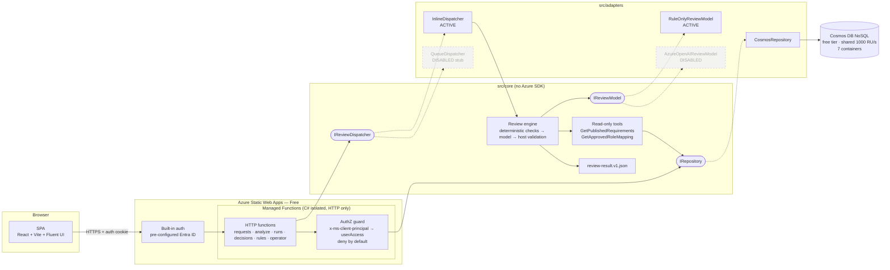
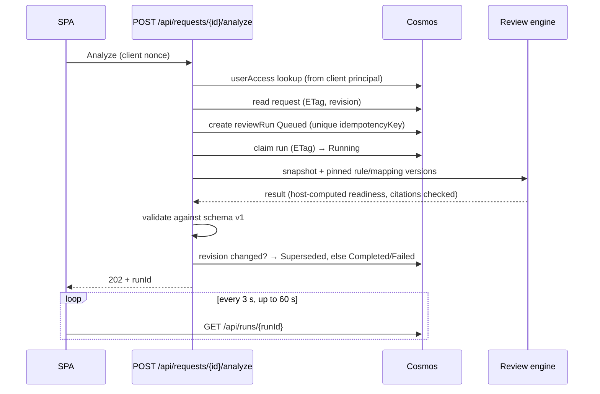

# Architecture — PMO Request Review Pilot

Scope is the locked v1.0 scope. Only the hosting stack changes for the pilot. Every paid component sits behind an interface so the same code is promoted later.

## Component diagram

Solid lines run in the pilot. Dashed boxes are coded, tested with mocks, and switched off by config.

## Stack mapping (A1)

| Locked design (paid) | Zero-cost pilot (Azure) | Promotion path (paid, later) |
|---|---|---|
| Model-driven Power App | SWA **Free**, SPA UI | Keep SWA (Standard) or move UI to Power Apps |
| Entra sign-in via Power Apps | SWA built-in auth, pre-configured Entra ID | SWA Standard custom Entra app registration |
| Dataverse tables + security roles | Cosmos DB NoSQL **free tier** + server-side `userAccess` | Dataverse, or Cosmos with managed identity |
| Dataverse plug-in snapshot | API creates snapshot + SHA-256 server-side | Dataverse custom API |
| Power Automate processing flow | `IReviewDispatcher` → `InlineDispatcher` | Queue-triggered Function or Power Automate flow |
| Azure Functions (isolated) | SWA **managed** Functions, C# isolated, HTTP only | BYO Function App + managed identity + Key Vault |
| Azure OpenAI reviewer | `IReviewModel` → `RuleOnlyReviewModel` | `AzureOpenAIReviewModel` (coded, tested, disabled) |
| Application Insights | Off; structured logs only | App Insights with sampling |
| Azure Pipelines | SWA CLI deploy | Azure Pipelines, multi-stage |

## Analyze flow (pilot)

**Honest limitation:** in the pilot the engine runs inside the Analyze HTTP call. The SWA gateway cuts API calls at 45 s (`VERIFIED_FACTS` F3), so the processing budget is capped well below that. If the browser closes after the request is accepted, the function keeps running and persists the run; the user sees it in history on return. A true background queue is the paid `QueueDispatcher` path.

## Trust boundaries
1. Browser → SWA: authenticated by SWA. Everything from the browser is untrusted, including body fields naming users or projects.
2. Function → Cosmos: connection string from SWA app settings (no managed identity on managed Functions, F2).
3. Request text → reviewer: untrusted content. Never interpreted as instructions.
4. Reviewer output → host: untrusted. Host recomputes readiness and validates every citation against pinned versions.
