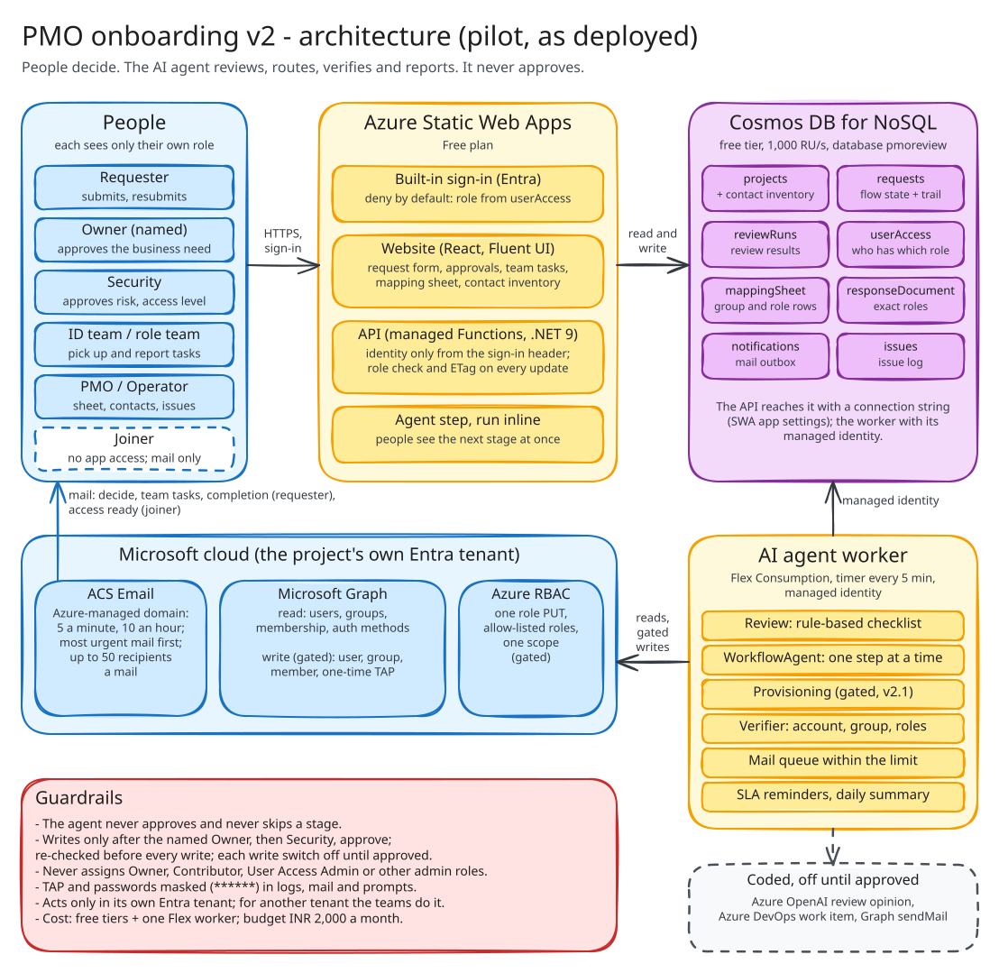
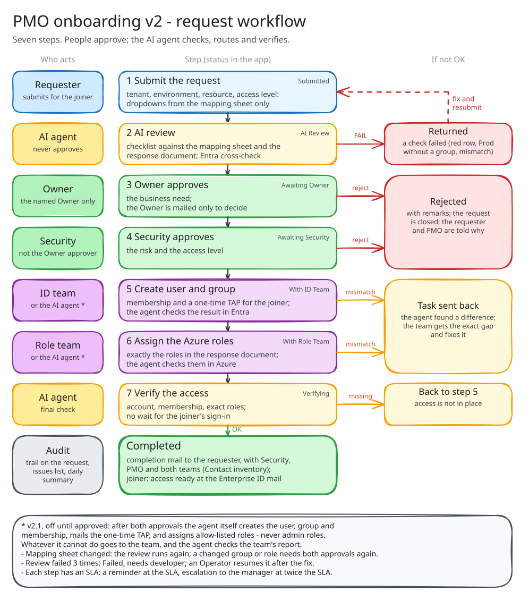
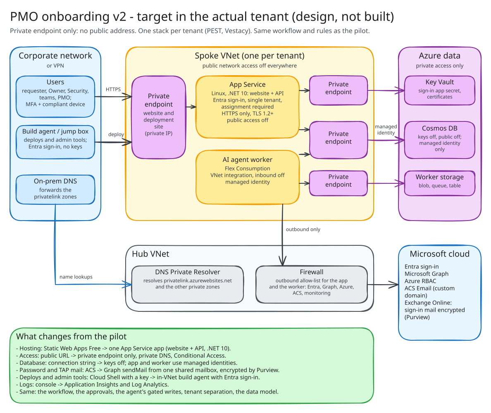

# Architecture — PMO onboarding flow (v2 with the 21–22 Oct changes, go-live release)

Updated 23 Oct 2026 for code at `fd5491c`. Diagrams redrawn 24 Oct 2026 in Excalidraw; editable sources in `docs/diagrams/`.
Scope: `SCOPE.md`. Platform facts: `docs/VERIFIED_FACTS.md` (F-numbers below).
Sections 2–11 describe the **pilot as deployed**. Section 12 describes the **target in the actual tenant**: App Service, private endpoint only, encrypted sign-in mail. That target is a design, not built yet (details: `docs/SECURE_HOSTING_AND_MAIL.md`).

The AI agent reviews, validates, summarises, routes, tracks, verifies and reports. It **never approves**.
People decide: the named Owner, then Security.
After both approvals, the agent (deterministic code, not the AI model) can create the account and group and assign allow-listed roles, if that is switched on. Otherwise the ID team and the role assignment team do it and record what they did.

## 1. What changed, by date

- **17 Oct (v2):** the flow is AI review → Owner → Security → ID team → role team → AI verification.
- **17 Oct (v2.1, approval-gated):** the agent creates the user, the group and the membership, and assigns allow-listed Azure roles. A refused write is retried for 24 h while a new permission reaches the worker.
- **21 Oct:**
  - tenant separation (one project = one Entra tenant);
  - environments (Dev / Test / PreProd / Prod);
  - workbook import;
  - several roles per group;
  - mail through Azure Communication Services;
  - an approval page.
- **22 Oct:**
  - the agent TAP: one one-time pass, mailed once with the initial password and the MFA steps;
  - a dropdown-only request form;
  - the real PEST and Vestacy data, with the SAMPLE data removed;
  - people registered by sign-in name;
  - the role allow-list built from the mapping sheet;
  - privileged rows handled by the agent (approval-gated);
  - a team can hand a task back to the agent.
- **22 Oct (go-live release):**
  - the completion mail goes to the requester, not the Owner;
  - verification no longer waits for the joiner's sign-in;
  - a Contact inventory page;
  - mail goes out within the sender's limit, most urgent first.

## 2. Components (pilot)

**How to read it**
- Top row: people use the website and API on Static Web Apps; all data lives in Cosmos DB.
- Bottom row: the AI agent worker runs every 5 minutes. It reads and writes Cosmos, and calls Microsoft Graph, Azure RBAC and ACS Email in the project's own tenant. ACS sends the mail back to the people.
- Colours: blue = people and Microsoft services; yellow = our compute (website, API, worker); purple = data; red = guardrails; grey dashed = coded but off.
- Editable source: [`diagrams/pmo-architecture-v2.excalidraw`](diagrams/pmo-architecture-v2.excalidraw) (open it at excalidraw.com).

### Component catalogue

**Website (SPA)**
- Code: `src/web` (React, Vite, TypeScript, Fluent UI v9).
- Pages:
  - request form: tenant, environment, resource and access level come from the mapping sheet only; the Enterprise ID is a mail address; a justification template;
  - request list and status;
  - Owner and Security approval panel;
  - ID team and role team tasks, with pick-up, report and hand-back;
  - mapping sheet (PMO edits rows);
  - response document;
  - contact inventory;
  - issues and reports.
- The header shows the environment (PROD, or a yellow test bar).

**Sign-in**
- Static Web Apps built-in, using the pre-configured Entra provider.
- Any Microsoft account can sign in (F10). It sees nothing unless `userAccess` gives it a role (deny by default).
- `/logout` goes to a public `signed-out.html`.

**API**
- Code: `src/api` runs on Static Web Apps managed Functions (.NET 9 isolated, HTTP only). The logic is in `src/core`: `ApiHost`, `Endpoints`, `RequestService`, `WorkflowService`, `MappingSheetService`, `ContactInventoryService`.
- No managed identity (F2) and a 45-second limit (F3). It reaches Cosmos with a connection string held in the Static Web Apps app settings.
- It runs the agent step inline after each action, so people see the next stage at once.

**AI agent worker**
- Code: `src/worker`, a timer every 5 minutes on Flex Consumption, with a system-assigned managed identity.
- It runs `WorkflowAgent.AdvanceAsync` for every open request:
  - Entra checks;
  - provisioning and role assignment;
  - verification;
  - SLA reminders and escalation;
  - the mail queue and the daily summary.

**Workflow core**
- Code: `src/core/Workflow`.
- `WorkflowState` holds the stages, kept in the request document.
- `WorkflowAgent` computes one step at a time. Provisioning is in `WorkflowAgent.Provisioning.cs`.
- `Verifier` checks the ID team and role team reports and does the final check.
- `Notifier` handles the outbox and issues. `Reports` builds the daily and developer reports.

**Review**
- Code: `src/core/Review`.
- `ReviewEngine` and `ReviewChecks` are the deterministic checklist against the mapping sheet and the response document.
- `InjectionDetector` turns request text that claims "already approved", or carries instructions, into findings.
- `ResultAssembler` and `ResultSchema` validate the result against `schema/review-result.v2.json`.

**Data**
- Cosmos DB for NoSQL, free tier, shared 1,000 RU/s, database `pmoreview`.
- Containers: `projects` (with the Contact inventory, versioned), `requests`, `reviewRuns`, `userAccess`, `mappingSheet`, `responseDocument`, `notifications`, `issues`.
- Code: `CosmosDocumentStore`, with ETag concurrency on every update.

**Directory (Entra)**
- `GraphDirectoryReader` does the reads.
- `GraphDirectoryWriter` makes the only Graph writes: POST user, POST group, POST member, POST TAP.

**Azure roles**
- `ArmRoleAssignmentWriter` makes one PUT per role assignment.
- `ArmRoleAssignmentReader` (optional, off) reads existing assignments.

**Mail**
- `AcsEmailSender`: Azure Communication Services Email, managed identity, Azure-managed domain, one mail per 50 recipients.
- `GraphMailSender`: optional, off.
- `NotificationDispatcher`: the queue within `MAIL_MAX_PER_MINUTE` / `MAIL_MAX_PER_HOUR` (5 / 10, F70).
- `IDirectMail`: sends the agent TAP mail.

**Reviewer models**
- `RuleOnlyReviewModel` is active: deterministic, no AI model.
- `AzureOpenAIReviewModel` and `AzureOpenAIAssistant` are coded and off (section 3).

**Audit**
- The trail is kept in the request, and the issues list.
- `AzureDevOpsWorkItemTracker` (optional, off).

**Infrastructure**
- `infra/main.bicep` with modules `pilot`, `worker` and `email`.
- An Azure Policy limits the allowed resource types.
- A Cost Management budget.

**Tools**
- `tools/deploy_free.sh`: whatif / apply / app / worker / grant-graph / provisioning / tap / privileged / environment / email.
- `import_workbook.py`, `register_user.py`, `sheet_roles.py`.
- `verify_features.sh`, `workflow_diag.sh`, `cost_check.sh`, `run_acceptance.sh`, `mac_setup.sh`.

## 3. Use of LLMs

### When requests run: no LLM is active today

The "AI agent" is deterministic C# (`WorkflowAgent`). The name describes its job (review, route, verify, report), not a language model.
The active reviewer is `RuleOnlyReviewModel`, a fixed checklist. No request text goes to any model.

### Coded and switched off: Azure OpenAI (each needs approval, docs/PROMOTION.md)

**AI review opinion** (`AzureOpenAIReviewModel`, stage 2)
- It adds concerns to the checklist result.
- The checklist still decides PASS / FAIL. The model can add a failed AI check, which returns the request. It can never remove a failed check, approve, create or assign.
- Settings: temperature 0, structured output with a strict JSON schema (`onboarding_review`), prompt version `aoai-review-v2`. Each run records the provider, the deployment and the prompt version.
- Limits (`ReviewLimits`):
  - 30-second time budget;
  - 24,000 input characters;
  - 1,500 output tokens;
  - at most 3 retries on HTTP 429, honouring `retry-after-ms`.

**AI analysis in reports** (`AzureOpenAIAssistant`, worker only, `AI_REPORTS=true`)
- Its one call is `AnalyseAsync(purpose, facts)`.
- It adds a written analysis to the daily summary and to the developer report.
- It never changes a request.

**Connection** (`AzureOpenAIChat`)
- Managed identity with the role Cognitive Services OpenAI User. No keys.
- Default endpoint: the GA `v1` endpoint (`/openai/v1/chat/completions`) with audience `https://ai.azure.com/.default` (F53).

**Switch**
- Set `REVIEW_MODEL_PROVIDER=AzureOpenAI` and `ALLOW_PAID_SERVICES=true` (startup refuses a paid provider without it).
- The review runs in the API, and the API has no managed identity. So the review needs the API moved to its own Function App first (PROMOTION swap 2).

**Guardrails around any model**
- `SecretMasker` masks secrets and TAPs (`******`) before a prompt.
- Request text is untrusted (`InjectionDetector`).
- The host validates the model output against the schema and recomputes the outcome.
- The model never decides and never writes.
- A data owner must sign off before request text is sent to the model.

### During development: Claude Code (Anthropic)

- The code, tests and docs were written and tested with Claude Code in cloud sessions.
- Claude Code is not part of the running system. The app makes no Anthropic or Claude call.
- Rules for those sessions:
  - never paste a TAP, password, connection string or personal user id;
  - real workbooks stay out of git;
  - Azure changes are run by people, after approval.
- Prompts for the enterprise build: `docs/ENTERPRISE_CLAUDE_PROMPTS.md`.

## 4. Request lifecycle

**How to read it**
- Read from top to bottom. Each row shows who acts, the step, and the status the app shows (top right of each step).
- The right-hand column shows what happens when a step is not OK: returned to the requester, rejected, or sent back to a team.
- Colours: blue = requester; yellow = AI agent; green = approvers and the completed request; purple = ID team and role team (or the agent, when v2.1 is switched on); red = stops; grey = audit and notes.
- Editable source: [`diagrams/pmo-request-workflow-v2.excalidraw`](diagrams/pmo-request-workflow-v2.excalidraw).

- After a mapping change, the review runs again. If the reviewed group and role are unchanged, the request resumes its stage. Otherwise the approvals are superseded and it goes back to Awaiting Owner.
- **Hand-back:** a team that was given a task (agent off, row not allowed) can hand it back. The agent re-checks and takes it once the row is allowed.

## 5. Agent provisioning path (after both approvals, each switch approval-gated)

1. **Re-check:** both current approvals, the tenant (`AGENT_TENANT_ID`), the domain (`--domain-suffix`), and the row. A row is refused if it is a guest, ambiguous, missing a group, or privileged without `AGENT_PRIVILEGED`.
2. **Group:** created when the mapping sheet says "to be created".
3. **User:** created with an initial password that must be changed at first sign-in.
4. **Membership:** the user is added to the group.
5. **Agent TAP** (if `AGENT_TAP`): one one-time pass (`AGENT_TAP_LIFETIME_MINUTES`, within the tenant's policy). It is mailed once with the password and the MFA steps to the Enterprise ID mail. Only a masked copy is stored. The account is created only when this mail can go out in the same run.
6. **Roles:** the row's roles are assigned to the group, all or nothing, only roles in `ROLE_ASSIGN_ALLOWED_ROLES` and within `ROLE_ASSIGN_SCOPES`. Never Owner, Contributor, User Access Administrator, RBAC Administrator, Reservations Administrator or Key Vault Data Access Administrator (`BuiltInRoles.NeverByAgent`). These are refused in code and again in the RBAC condition.
7. **Failure:** any failure goes to the team, with the reason and an issue. A refused write is retried for 24 h while a new permission reaches the worker (F61).

## 6. Notifications

- **Who gets what:**
  - the Owner is mailed only to decide, and Security for its stage;
  - the requester gets the one completion mail, together with Security, PMO, the ID team and the role team;
  - the joiner gets *access ready* at the Enterprise ID mail;
  - the requester and Security get the provisioning summaries.
- **Team addresses:** from the Contact inventory. The lists are semicolon-separated, versioned, and saved by PMO and Operators; every change is mailed to Security and PMO. The addresses route mail only; approval rights stay in `userAccess`.
- **Limits:**
  - approvals and team tasks go first;
  - a throttled mail (429) waits without using an attempt;
  - a backlog raises an issue;
  - each mail has at most 50 recipients, and bad addresses are skipped;
  - guest sign-in names are mailed at the real mailbox;
  - an approval or task that reaches nobody raises a High issue.
- **Test environments:** `NOTIFY_REDIRECT_TO` sends every mail to one test mailbox, naming the intended recipients. It is refused in prod.

## 7. Tenants and environments

- One project = one Entra tenant (PEST, Vestacy). Requests, rows, contacts, roles and mail never cross projects.
- The agent reads and writes Entra and Azure only for projects in its own tenant (`AGENT_TENANT_ID` = the worker's tenant). For another tenant the checks say "not checked by the agent", and the teams do the work there.
- Each project lists its environments. The request picks one, and the mapping row must match it. Prod without a group is returned.
- `APP_ENVIRONMENT` = pilot | dev | test | prod.

## 8. Stage → code

- **Intake:** `Services/RequestService`. Dropdown values must come from the mapping sheet. The Enterprise ID must be a mail address. The justification template must have no unfilled `[ … ]`.
- **AI review:**
  - code: `Review/ReviewEngine`, `ReviewChecks`, `Processing/RunService`, `ReviewProcessor`;
  - reads both sources fresh;
  - validates the result against the schema;
  - stores a fingerprint of the sheet.
- **Approvals:** `WorkflowService.RespondAsync`. Only the named Owner (matched by sign-in name), then Security (not the Owner approver). Anyone else is ignored, logged as an *Unauthorized approval* issue, and Security is alerted.
- **ID team:**
  - the agent's path: `WorkflowAgent.Provisioning`;
  - the team's path: `ReportIdTeamAsync` with `Verifier.IdTeamAsync`;
  - a report body that carries a pass is rejected;
  - hand-back: `HandBackAsync`.
- **Role team:**
  - the agent's path: `ArmRoleAssignmentWriter`;
  - the team's path: `ReportRoleTeamAsync` with `Verifier.RoleTeamAsync`;
  - the exact roles are checked against the response document.
- **Final:** `WorkflowAgent.FinalAsync` and `Verifier.FinalAsync` check the account, the membership and the exact roles once, then the request completes, the completion mail goes out and the trail is written.
- **SLA:** `ApprovalSlaAsync` / `TaskSlaAsync` send a reminder at the SLA and escalate to the manager at twice the SLA. Managers come from the Contact inventory or Graph.
- **Issues and reports:** `Notifier` (`IssueLog`) and `Reports` (daily summary, developer report).

## 9. API (all under `/api`, signed in)

Identity comes only from `x-ms-client-principal`. A project the caller has no role in returns 404; a missing permission returns 403. Updates need `If-Match`.

- `GET me`, `GET queue`: any signed-in user.
- `GET/POST projects/{p}/requests`, `GET/PUT …/requests/{id}`, `GET …/{id}/trail`: members; the Requester submits and resubmits.
- `POST …/{id}/approvals`: the named Owner, then Security.
- `POST …/{id}/tasks/{id-team|role-team}/pickup`, `…/handback`, `…/report`: IdTeam / RoleTeam.
- `POST …/{id}/advance`, `POST …/{id}/resume`: Operator.
- `GET/POST projects/{p}/mapping-sheet`, `PUT …/{rowId}`, `POST …/{rowId}/group`: members; PMO edits; IdTeam records a created group.
- `GET/PUT projects/{p}/contacts`: every role reads; PMO and Operators save.
- `GET projects/{p}/response-document`: members.
- `GET projects/{p}/issues`, `GET …/reports/daily/{date}`, `GET …/reports/developer`: Security, PMO, Operator.
- `GET …/requests/{id}/runs`, `GET projects/{p}/runs/{runId}`, `POST …/runs/{runId}/retry`, `POST …/operator/recover`: members / Operator.

## 10. Trust boundaries and permissions

1. **Browser → Static Web Apps:** signed in by Static Web Apps; every field in a request body is untrusted. People are found in `userAccess` by user id or by sign-in name.
2. **API → Cosmos:** connection string in the Static Web Apps app settings (managed Functions have no managed identity). The API never holds a writer for Entra or Azure.
3. **Worker → Cosmos / Graph / Azure / mail:** managed identity.
   - Cosmos: data roles only on the containers it uses.
   - Graph read: `User.Read.All`, `GroupMember.Read.All`, `UserAuthenticationMethod.Read.All`. `AuditLog.Read.All` is still granted but no longer used.
   - Graph create (gated): `User.Create`, `Group.Create`, `GroupMember.ReadWrite.All`.
   - TAP (gated): `UserAuthMethod-TAP.ReadWrite.All`.
   - Azure: Role Based Access Control Administrator on one scope, limited by a condition to the allow-listed roles and to user and group principals.
   - Mail: a role on the Communication Services resource.
4. **Untrusted content:** request text, team notes and any model output. It is masked (`SecretMasker`) before logs, ADO, mail and prompts. The host validates every result.

## 11. Design decisions

- **Workflow state in the request document (`flow`):** one document and one ETag, so a stage change and its audit entry commit together.
- **The agent runs inline in the API and on the worker timer:** people see the next stage at once, and Entra work finishes within about 5 minutes.
- **Agent writes are deterministic, gated and re-checked:** the AI model never decides or writes. Every write needs both current approvals and its switch on.
- **One stack per tenant:** a managed identity has rights only in its own tenant, so cross-tenant writes are not built.
- **Contact inventory on the project document:** no new container; versioned; separate from approval rights.
- **The mail queue honours the sender's limit:** nothing is lost when the Azure-managed domain sends only 10 an hour (F70).
- **No sign-in wait at completion:** access is verified directly, and the sign-in log check (Entra P1/P2) is no longer needed.
- **Private endpoint only in the actual tenant (section 12):** internal users only, so there is no public address. Entra sign-in, Conditional Access and private DNS replace a public edge.
- **`az deployment sub what-if` before every resource change:** the resource group is created by the deployment, so it passes the approval gate too.

## 12. Target architecture in the actual tenant (private endpoint only, design)

Status: a design agreed on 23 Oct 2026; not built or deployed. Build tasks A10–A12 are in `docs/ENTERPRISE_CLAUDE_PROMPTS.md`; settings and *(verify)* items are in `docs/SECURE_HOSTING_AND_MAIL.md`.
There is one stack per tenant (PEST, Vestacy). Each stack lives in a subscription of its own tenant.

**How to read it**
- Users and the build agent reach the app only through a private endpoint (private IP) from the corporate network.
- The app and the worker reach Key Vault, Cosmos DB and the worker storage only through private endpoints, with managed identities.
- Outbound traffic to Microsoft (Entra, Graph, Azure, ACS, Exchange) goes only through the hub firewall's allow-list. Name lookups go through the hub's DNS Private Resolver.
- Colours: blue = corporate network and Microsoft cloud; yellow = spoke VNet and our compute; purple = private endpoints and data; grey = hub VNet; green = what changes from the pilot.
- Editable source: [`diagrams/pmo-target-architecture.excalidraw`](diagrams/pmo-target-architecture.excalidraw).

### Pilot → target, component by component

- **Website and API**
  - Pilot: Static Web Apps Free with managed Functions (.NET 9).
  - Target: **one App Service app** (Linux, .NET 10). A new host, `src/webhost`, serves the website and reuses `ApiHost`.
- **Sign-in**
  - Pilot: the pre-configured provider, where any Microsoft account can sign in.
  - Target: App Service sign-in with Entra, **single tenant**, "assignment required", and Conditional Access (MFA, compliant device).
  - `ClientPrincipalParser` reads App Service's `X-MS-CLIENT-PRINCIPAL` (`oid`, `preferred_username`) and rejects any `tid` other than the tenant's.
- **Access**
  - Pilot: a public `*.azurestaticapps.net` URL.
  - Target: a **private endpoint only**, with public network access off on the app and its deployment site.
  - Name resolution: `privatelink.azurewebsites.net`, through the Private Resolver and the on-premises forwarders.
  - Optional: Application Gateway WAF v2 with a private front end, if Security asks for a WAF.
- **TLS**
  - Target: HTTPS only, minimum TLS 1.2.
  - The default `*.azurewebsites.net` name keeps its Microsoft certificate. A custom domain uses the org's certificate from Key Vault.
- **Database**
  - Pilot: Cosmos free tier with a connection string in the app settings.
  - Target: Cosmos with **keys off** and **public access off**, reached through a private endpoint. The app and the worker use their managed identities (Cosmos DB Built-in Data Contributor).
- **Secrets**
  - Pilot: none stored, except the Cosmos connection string.
  - Target: **Key Vault** (private endpoint) for the sign-in app secret and any certificate, read with the managed identity.
- **Worker**
  - Pilot: Flex Consumption with public inbound.
  - Target: Flex Consumption with **VNet integration** and **inbound off**. Its storage is reached through private endpoints (blob, queue, table).
  - Outbound goes through the firewall allow-list: Entra, Graph, `management.azure.com`, Azure Communication Services, monitoring.
- **Normal mail**
  - Unchanged: Azure Communication Services Email, with a custom verified domain to lift the 10-an-hour limit (F70).
- **Password and TAP mail**
  - Pilot: Azure Communication Services, protected in transit only.
  - Target:
    - **Graph `sendMail` from one shared mailbox** with the header `x-pmo-sensitivity: signin`;
    - an Exchange mail flow rule applies **Purview Message Encryption**;
    - `Mail.Send` is limited to that mailbox by Exchange RBAC for Applications;
    - `REQUIRE_ENCRYPTED_SIGNIN_MAIL` refuses any other path in prod;
    - optional: the password is not mailed (`AGENT_SEND_PASSWORD=false`).
- **Logs**
  - Pilot: the console.
  - Target: Application Insights and Log Analytics (through an Azure Monitor Private Link Scope if the org requires it), plus diagnostic settings.
- **Deploy and admin tools**
  - Pilot: Cloud Shell, with the Cosmos key.
  - Target: a **self-hosted Azure DevOps agent** (or a jump box through Bastion) **inside the VNet**.
  - The tools sign in to Cosmos with Entra, not a key.
  - The pipeline uses workload identity federation and approval checks.

### Trust boundaries in the target
1. **Users → app:** only from the corporate network (private IP). Entra single-tenant sign-in and Conditional Access come first, then `userAccess` (deny by default).
2. **App → Cosmos and Key Vault:** managed identity over private endpoints. No key or connection string exists anywhere.
3. **Worker → Microsoft cloud:** managed identity, outbound only through the allow-list. The Graph and RBAC rights are the same as the pilot, each switch approval-gated, plus `Mail.Send` limited to the shared mailbox.
4. **Operators → data:** only from the in-VNet agent or jump box, with their own Entra identity and a Cosmos data role. Every action is logged.

### What stays the same
- The workflow, the approval rules, the agent's gated writes, tenant separation, the AI review (rule-based; Azure OpenAI still off) and the data model.
- Joiners never use the app. They use `aka.ms/mysecurityinfo` and `myapps.microsoft.com` (public Microsoft services).
