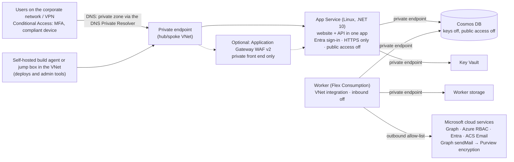

# Secure hosting and encrypted sign-in mail (actual tenant)

Written 23 Oct 2026. Design only: nothing here is built or deployed yet.
The code work is tasks A10–A11 in `docs/ENTERPRISE_CLAUDE_PROMPTS.md`.
Items marked *(verify)* must be checked on Microsoft Learn before the build and recorded in `docs/VERIFIED_FACTS.md`.

## 1. Short answer

- **HTTPS:** Static Web Apps is already HTTPS only. Its weak points are elsewhere:
  - the site is public;
  - any Microsoft account can sign in (F10);
  - the database key sits in the app settings.
- **Recommended:** host the website and the API in **one Azure App Service app** in the actual tenant:
  - HTTPS only, minimum TLS 1.2;
  - App Service sign-in (Entra, single tenant);
  - **private endpoint only** (confirmed 23 Oct 2026): reachable only from the corporate network. No Front Door, no public URL;
  - managed identity to Cosmos, with Cosmos keys off.
- **Encrypted mail, only for the password and TAP mail:**
  - send that one mail through **Microsoft Graph from a shared mailbox** in the actual tenant, with a marker header;
  - an Exchange **mail flow rule** applies **Microsoft Purview Message Encryption** to it;
  - every other mail stays on Azure Communication Services, unencrypted.
- **Better still:** stop mailing the password. The one-time TAP is enough to sign in and set up Authenticator.

## 2. Hosting options

**A. Static Web Apps Standard (smallest change)**
- Adds custom Entra sign-in, a private endpoint and a custom domain.
- The managed API still has no managed identity, so it also needs its own Function App.
- That gives two hosts, two sign-in cookies and more moving parts.

**B. App Service, one app for the website and the API (recommended)**
- One origin, one sign-in, one set of security settings.
- Full control of TLS, headers, the network and logs.
- The code already has a second host for the same API logic (`tools/local-api` serves the same `ApiHost`), so the change is small.

**C. Container Apps**
- Also possible.
- More work: images, a registry, an environment. Not needed here.

## 3. Recommended design (option B)

### Settings checklist

**App Service**
- HTTPS Only: on.
- Minimum TLS: 1.2 (1.3 if every client supports it).
- FTP and basic publishing credentials: off.
- Remote debugging: off.
- Public network access: **off**, with the private endpoint as the only way in. The deployment (SCM) site goes private with it.

**Sign-in**
- App Service authentication with an Entra app registration (single tenant).
- "Assignment required" on the enterprise app, with only the user groups assigned.
- Unauthenticated requests are redirected to sign-in.
- A Conditional Access policy on the app: MFA, and a compliant or hybrid-joined device.

**Certificates**
- The simplest choice: keep the default `<app>.azurewebsites.net` name. It already has a Microsoft certificate, and the private DNS zone resolves it to the private endpoint.
- For a custom domain, use a certificate from the org's certificate authority (or a public one) stored in Key Vault. App Service managed certificates need the app to be publicly reachable *(verify)*, so they don't fit a private-only app.

**Security headers** (added in the host)
- `Strict-Transport-Security`
- `Content-Security-Policy` (`default-src 'self'`, `frame-ancestors 'none'`)
- `X-Content-Type-Options: nosniff`
- `Referrer-Policy: no-referrer`

**Secrets and data**
- No secret in app settings: Key Vault references read with the managed identity.
- Cosmos: `disableLocalAuth: true`, a private endpoint, and the role Cosmos DB Built-in Data Contributor for the app and the worker.

**Network**
- A spoke VNet peered to the org's hub, with subnets for the private endpoints and for the worker's VNet integration.
- Private DNS zones, linked to the hub:
  - `privatelink.azurewebsites.net` (the app and its deployment site);
  - `privatelink.documents.azure.com`;
  - `privatelink.vaultcore.azure.net`;
  - `privatelink.blob/queue/table.core.windows.net` (the worker's storage).
- The on-premises DNS forwards those zones to the Azure DNS Private Resolver, so laptops on the corporate network or VPN find the private IP.
- The worker: inbound public access off (it is a timer, so nobody calls it).
- Outbound through the org's firewall needs an allow-list *(verify the full list)*:
  - `login.microsoftonline.com` and `graph.microsoft.com`;
  - `management.azure.com`;
  - the Azure Communication Services endpoint (`*.communication.azure.com`);
  - Application Insights ingestion, or an Azure Monitor Private Link Scope if the org requires one.

**Logs**
- Application Insights and Log Analytics.
- Diagnostic settings for App Service and the WAF.

### Code changes (prompt A, task A10)

1. **New host** `src/webhost` (ASP.NET Core, .NET 10). It reuses `ApiHost` for `/api/*` and serves the built website from `wwwroot`.
2. **Sign-in header:**
   - `ClientPrincipalParser` must also read App Service's `X-MS-CLIENT-PRINCIPAL`, which is a list of claims, unlike the Static Web Apps format.
   - Map `oid` to the user id, and `preferred_username` (or `upn`) to the sign-in name.
   - Reject a `tid` that is not the expected tenant.
   - Accept the header only from App Service sign-in, never from the client.
3. **Website:** read `/.auth/me` in App Service's format.
4. **Routes:** move the `staticwebapp.config.json` rules (logout redirect, blocked providers, signed-out page) into the host.
5. **Database:** Cosmos with managed identity only (already coded: `COSMOS_ENDPOINT` without a connection string).
6. **Tests:**
   - an App Service principal with the wrong `tid` is denied;
   - a request without the header is denied;
   - the security headers are present;
   - the existing access tests run on both principal formats.

### What private-endpoint-only access changes

1. **Deploys come from inside the network.** Cloud Shell and Microsoft-hosted pipeline agents can't reach the private app or its deployment site. Use one of these:
   - a self-hosted Azure DevOps agent in the VNet (recommended);
   - Cloud Shell deployed into the VNet;
   - a jump box reached through Azure Bastion.
   This also applies to the commands in `docs/GO_LIVE_ACTUAL_TENANT.md`.
2. **Admin tools stop using the Cosmos key.**
   - With Cosmos keys and public access off, `import_workbook.py`, `register_user.py`, `verify_features.sh` and `workflow_diag.sh` must sign in with Entra: the operator's account, or the jump box's managed identity, with a Cosmos data role.
   - They must run inside the VNet.
   - This is a code change (task A12).
3. **Approvers must be on the network.** Owners, Security and the teams need the corporate network or VPN to open the app from a mail link.
   - Joiners don't need the app.
   - They use `aka.ms/mysecurityinfo` and `myapps.microsoft.com`, which are public Microsoft services.
4. **Sign-in still works.** The browser goes to `login.microsoftonline.com` (public, as for Microsoft 365) and returns to the private address. The app itself needs outbound access to Entra to check the sign-in.
5. **A WAF is optional.** Entra sign-in, Conditional Access and private-only access already block anonymous traffic. Add Application Gateway WAF v2 with a private front end only if Security requires a WAF.
6. **Mail is unchanged.** The worker reaches Azure Communication Services and Graph over its outbound allow-list; encryption is still applied in Exchange Online.

## 4. Encrypted mail: only the password and TAP mail

**Today:** one mail from Azure Communication Services to the Enterprise ID mail address.
- It is protected in transit (TLS), but it is not encrypted end to end.
- Anyone with access to that mailbox, or a forward rule, can read the TAP and the password.
- Azure Communication Services can't apply Microsoft Purview Message Encryption, because that runs in Exchange Online.

### Design
1. **Shared mailbox:** create one in the actual tenant, for example `onboarding-signin@<domain>`.
2. **Send through Graph:** the worker sends **only** the sign-in mail through Graph `sendMail` from that mailbox, with the header `x-pmo-sensitivity: signin`. Graph allows custom `x-` headers on a message *(verify)*.
3. **Mail flow rule** in Exchange Online:
   - when the sender is `onboarding-signin@…` and the header `x-pmo-sensitivity` is `signin`;
   - then apply Purview Message Encryption: template **Encrypt-Only**, or **Do Not Forward** to also block forwarding and copying.
4. **Recipients:**
   - Inside the tenant: they open it in Outlook as usual.
   - Outside (the joiner's current company mail): they get a protected-message link and read it after a one-time passcode or a Microsoft sign-in.
5. **Every other mail** (approvals, tasks, *access ready*, completion) stays on Azure Communication Services, unchanged.
6. **Prod guard:** a new setting `REQUIRE_ENCRYPTED_SIGNIN_MAIL=true`. With it, the worker refuses to send the sign-in mail through Azure Communication Services. If the encrypted path fails, the TAP goes to the ID team, as today.

**Permissions** (the Mail.Send permission needs Security approval):
- `Mail.Send` is granted **only in Exchange Online**, with **Exchange RBAC for Applications**: the role "Application Mail.Send", scoped to the one shared mailbox. An Exchange Administrator sets this up.
- **Do not** also grant Graph `Mail.Send` through Entra admin consent. An Entra grant is tenant-wide and adds to the Exchange scope, so the worker could then send as any mailbox *(verify)*.

**Licensing:** Purview Message Encryption comes with Microsoft 365 E3/E5 or Office 365 E3/E5, or with an add-on *(verify the org's plan)*.

### Code changes (prompt A, task A11)
1. A new setting `DIRECT_MAIL_SENDER=GraphMail` and `DIRECT_MAIL_FROM=<shared mailbox>`. `DirectMail` uses its own `GraphMailSender`, while notifications keep `NOTIFY_SENDER=AcsEmail`.
2. `GraphMailSender` adds `internetMessageHeaders` (`x-pmo-sensitivity: signin`) for the sign-in mail only.
3. `REQUIRE_ENCRYPTED_SIGNIN_MAIL`: on by default in prod; refuses the Azure Communication Services path.
4. Optional, recommended: `AGENT_SEND_PASSWORD=false`. The mail then carries only the TAP. The joiner signs in with the TAP, adds Authenticator, then sets a password (or goes passwordless).
5. Tests:
   - the sign-in mail never goes through Azure Communication Services when the setting is on;
   - the header is set only on the sign-in mail;
   - the masked stored copy is unchanged.

### Extra hardening for the TAP
- A shorter TAP lifetime in prod, for example 60–120 minutes. It is one-time already. Allow for time zones and start dates.
- Send the TAP mail only on the joiner's start date (a small scheduling change).
- Optional split channel: the TAP to the joiner, and a notice without the TAP to the requester.

## 5. Who does what

- **Network admin:**
  - VNet peering;
  - private endpoints and private DNS zones;
  - the DNS Private Resolver and the on-premises forwarders;
  - the firewall outbound allow-list;
  - optional private Application Gateway WAF.
- **DevOps engineer:** a self-hosted build agent (or jump box) in the VNet, used for every deploy and admin tool.
- **Subscription Owner:** App Service plan and app, Key Vault, the Cosmos private endpoint, role assignments for the managed identities.
- **Application Administrator:** the app registration for App Service sign-in, and "assignment required".
- **Conditional Access Administrator:** the MFA and device policy for the app.
- **Exchange Administrator:**
  - the shared mailbox;
  - Exchange RBAC for Applications (the scoped `Mail.Send`, after Security approval);
  - the mail flow rule for encryption.
- **Compliance Administrator:** Purview Message Encryption templates and branding.
- **Privileged Role Administrator:** nothing for mail. `Mail.Send` is not granted in Entra.
- **Security approver:** signs off the design, the WAF rules, `Mail.Send`, and whether the password is mailed at all.

## 6. Cost inputs (no prices; use the Azure Pricing Calculator)
- An App Service plan on a tier that supports private endpoints *(verify the tier)*. One instance for test, two for prod availability.
- No Front Door: access is private only.
- Optional Application Gateway WAF v2 (private front end).
- An Azure DNS Private Resolver, if the hub doesn't have one already.
- A self-hosted build agent VM or a jump box, plus Bastion.
- Private endpoints (per endpoint and GB) and the private DNS zones.
- Key Vault operations.
- Application Insights and Log Analytics ingestion.
- Purview Message Encryption licensing (usually already part of E3/E5).
